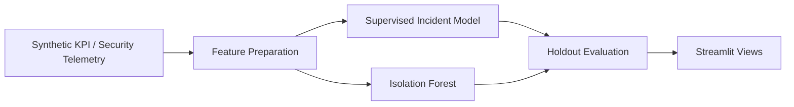

# Technical review — NetOps AI Incident Intelligence

## Problem
Explore whether network telemetry can support incident-risk classification and unsupervised anomaly detection.

## Architecture

## Reproduce

Start with the commands in the main README. Inspect `requirements.txt`, `src/train_model.py`, `train_anomaly.py`, `app.py`, and `anomaly_dashboard.py` where present before running. Do not assume these applications share one trained model or one data source.

## Review checklist

- Synthetic-data origin and any generated labels are clearly distinguished from real incidents.
- Train/test split and chronological holdout assumptions are documented.
- Precision, recall, F1 and ROC-AUC are evaluated with suitable class definitions.
- Isolation Forest contamination assumptions and thresholds are explained.
- Tests and CI are inspected for their actual coverage.
- No claims of production incident prevention or measured MTTR reduction are inferred from model experiments.

## Limitations
Real telecom data may have drift, rare events, missing telemetry, delayed labels, and deployment constraints not represented by synthetic datasets. This project demonstrates an approach, not operational validation.
